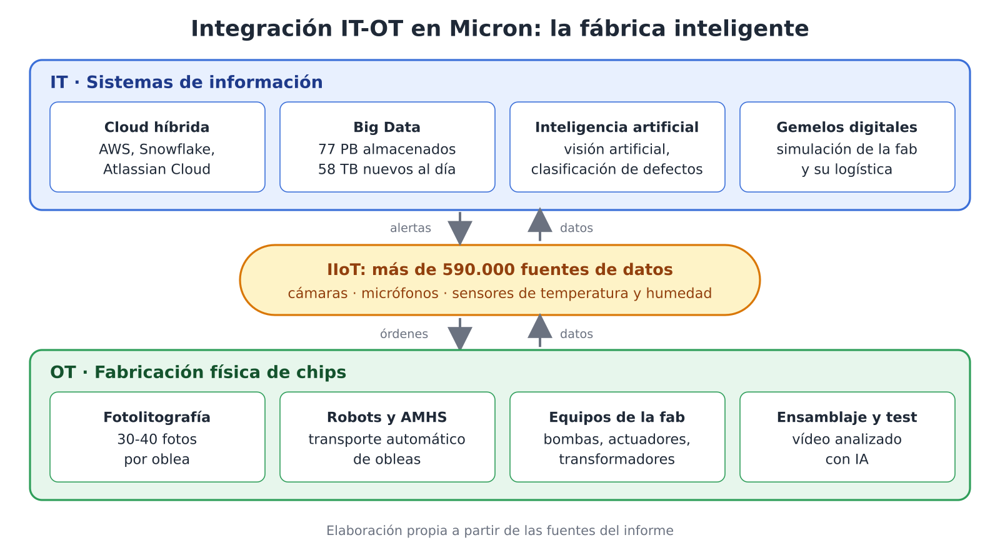

# Informe THD: Micron Technology

**Autores:** Al Frances Doydoy

**Fecha:** 24 de noviembre de 2026

**Módulo:** 1º DAW - DIGI

## 1. Datos de la empresa elegida

| Campo | Información |
|---|---| 
| **Nombre** | Micron Technology, Inc. — [www.micron.com](https://www.micron.com) |
| **Sector concreto** | Fabricación de semiconductores: diseño y producción de chips de memoria (DRAM, HBM) y almacenamiento (NAND, SSD) |
| **Sede** | Boise, Idaho (Estados Unidos), con fábricas en países como Singapur y Taiwán [3][8] |
| **Tamaño** | Grande: ingresos récord de 37.400 millones de dólares en el año fiscal 2025, un 49 % más que el año anterior [2] |
| **Producto o servicio principal** | Memoria y almacenamiento para centros de datos e IA, sobre todo memoria de alto ancho de banda (HBM), DRAM para servidores y SSD empresariales [2][4] |
| **Por qué la elegimos** | Fabrica el hardware del que dependen la nube y la IA y, a la vez, usa esas mismas tecnologías en sus fábricas, lo que la convierte en un ejemplo muy claro de integración IT-OT. |

Micron es uno de los mayores fabricantes de memoria del mundo. Durante casi 30 años vendió memoria RAM y SSD al público con la marca **Crucial**, pero en diciembre de 2025 anunció que abandonaba ese negocio de consumo. Los envíos de productos Crucial terminaron en febrero de 2026 [3]. El motivo fue dedicar su capacidad de producción a productos para centros de datos e inteligencia artificial, como la memoria HBM que usan los aceleradores de IA [4].

---

## 2. Resumen ejecutivo

Micron es un fabricante de chips de memoria con sede en Estados Unidos. Su negocio depende de producir obleas de silicio con la mayor calidad y rapidez posibles, y para ello ha convertido sus fábricas en **fábricas inteligentes**. El Foro Económico Mundial reconoció sus plantas de Singapur y Taiwán dentro de su Red de Faros Globales (*Global Lighthouse Network*) por liderar la llamada Cuarta Revolución Industrial [7][8].

En este informe se han identificado **cinco tecnologías habilitadoras digitales (THD)**:

1. **Inteligencia artificial**: visión artificial y aprendizaje profundo para detectar y clasificar defectos en las obleas.
2. **Internet industrial de las cosas (IIoT)**: cámaras, micrófonos y sensores conectados en toda la fábrica.
3. **Big Data y analítica**: petabytes de datos de fabricación analizados para mejorar el rendimiento.
4. **Cloud computing**: modelo de nube híbrida para el diseño de chips, el almacén de datos y las herramientas de trabajo.
5. **Robótica, automatización y gemelos digitales**: transporte automático de obleas y simulación de la fábrica.

La conclusión principal es que la **inteligencia artificial** es la THD más determinante. Micron la aplica dentro de sus fábricas y, además, es el principal motor de ventas de sus productos.

---

## 3. Análisis THD por THD

### 3.1. Inteligencia artificial (IA)

**Definición.** La inteligencia artificial es el conjunto de técnicas que permiten a un sistema informático realizar tareas que normalmente requieren inteligencia humana, como reconocer imágenes, detectar patrones o tomar decisiones. El aprendizaje profundo (*deep learning*) es la rama que usa redes neuronales entrenadas con grandes cantidades de ejemplos.

**Características principales:**

- **Aprendizaje a partir de datos**: el modelo mejora con ejemplos en lugar de programar cada regla.
- **Visión artificial**: interpreta imágenes y vídeo con más rapidez y constancia que una persona.
- **Decisión en tiempo real**: genera alertas o actúa pocos segundos después de recibir los datos.

**Aplicación en Micron.**

- **Detección de defectos por visión artificial.** En la fotolitografía, el paso en el que se "dibujan" los circuitos sobre la oblea, se toman entre 30 y 40 fotos de cada oblea. La IA analiza esas imágenes y puede lanzar una alerta segundos después de la captura [5].
- **Clasificación automática de defectos (AI-ADC).** Antes, los técnicos tenían que clasificar a mano los defectos de las obleas. Ahora un sistema de aprendizaje profundo ordena y clasifica millones de defectos [6].
- **Vídeo en ensamblaje y test.** La IA decide cuándo grabar para guardar solo los momentos críticos del proceso [5].
- **Planificación de la fábrica.** Micron usa agentes de aprendizaje por refuerzo que ajustan de forma autónoma los parámetros de planificación de la producción [9].

**Mejora en IT/OT.** La IA cierra el ciclo entre los datos (IT) y la máquina (OT): un defecto detectado en una imagen se corrige en la línea de producción antes de que afecte a más obleas. Según los datos del reconocimiento del Foro Económico Mundial, la detección de defectos ópticos con *deep learning* mejoró el rendimiento (*yield*) un 2 % [7]. Micron calcula que, entre 2016 y 2025, la IA y la analítica le han permitido reducir a la mitad el tiempo de lanzamiento de nuevos productos [5].

*Fuentes: [5], [6], [7], [9].*

---

### 3.2. Internet industrial de las cosas (IIoT)

**Definición.** El IoT es la red de objetos físicos (máquinas, sensores, cámaras) que envían datos a través de una red para monitorizarlos y controlarlos a distancia. Cuando se aplica a fábricas se llama IoT industrial (IIoT).

**Características principales:**

- **Sensores conectados** que capturan datos físicos: imagen, sonido, temperatura, humedad.
- **Plataforma común** que reúne datos de dispositivos muy distintos.
- **Monitorización continua** con alertas automáticas cuando algo se sale de lo normal.

**Aplicación en Micron.** En su fábrica de Singapur, Micron adoptó una plataforma IoT para integrar distintos tipos de sensores: de humedad, ópticos y de temperatura. Algunos los desarrolló la propia empresa [10]. Además de las cámaras, instaló **sensores acústicos** que registran el sonido de los brazos robóticos de la línea de producción. Si el sonido cambia respecto a lo normal, se avisa a los ingenieros [10]. Hoy Micron recoge datos de **más de 590.000 fuentes**. Por ejemplo, unos micrófonos situados junto a bombas y actuadores aprenden durante varias semanas cómo suena el equipo cuando funciona bien, y avisan si aparecen frecuencias nuevas. También vigila la temperatura de componentes como los transformadores para detectar sobrecalentamientos [5].

**Mejora en IT/OT.** El IIoT es el "puente" entre los dos mundos: convierte lo que pasa en las máquinas (OT) en datos que los sistemas informáticos (IT) pueden analizar. Permite pasar del mantenimiento reactivo (arreglar cuando se rompe) al **mantenimiento predictivo** (avisar antes de que falle). Según el Foro Económico Mundial, la fábrica inteligente con IIoT redujo un 22 % el material desechado o rebajado de calidad [7].

*Fuentes: [5], [7], [10].*

---

### 3.3. Big Data y analítica de datos

**Definición.** Big Data es el conjunto de tecnologías que permiten almacenar, procesar y analizar volúmenes de datos tan grandes, variados y rápidos que no se pueden gestionar con herramientas tradicionales, con el fin de extraer información útil.

**Características principales (las "V" del Big Data):**

- **Volumen**: cantidades enormes de datos, del orden de petabytes.
- **Velocidad**: datos que llegan de forma continua y deben procesarse rápido.
- **Variedad**: imágenes, sonido, lecturas de sensores, datos de producción.

**Aplicación en Micron.** La fabricación de un chip tiene cientos de pasos y cada uno genera datos. Micron tiene **77 petabytes** de datos de fabricación almacenados y captura **58 terabytes nuevos cada día**. Cada semana, sus modelos de IA analizan 436 millones de puntos de control [5]. Para aprovechar estos datos, tiene grandes plataformas de gestión del rendimiento que utilizan más de **14.000 personas** de la empresa [5]. Su uso de la analítica empezó con análisis estadísticos sencillos de los procesos y evolucionó hacia modelos de *deep learning* [7]. Para almacenar los datos, migró **500 TB** desde un almacén de datos antiguo instalado en sus servidores, que llegaba a funcionar semanas en estado degradado por fallos de disco, a Snowflake, un almacén de datos en la nube [11].

**Mejora en IT/OT.** En IT, centralizar los datos evita que cada fábrica o departamento trabaje con su propia versión. En OT, la analítica avanzada aplicada a los procesos, junto con los fabricantes de equipos, redujo un 50 % el tiempo necesario para poner en marcha la producción de un producto nuevo [7].

*Fuentes: [5], [7], [11].*

---

### 3.4. Cloud computing

**Definición.** El cloud computing consiste en usar recursos informáticos (servidores, almacenamiento, bases de datos, aplicaciones) a través de Internet y pagar por uso, en lugar de mantener toda la infraestructura propia. La **nube híbrida** combina servidores propios (*on-premise*) con nube pública.

**Características principales:**

- **Escalabilidad bajo demanda**: se amplía la capacidad en los picos y se reduce cuando no hace falta.
- **Pago por uso**: no hay que comprar hardware para necesidades puntuales.
- **Acceso global**: equipos de varios países trabajan sobre los mismos datos y herramientas.

**Aplicación en Micron.**

- **Diseño de chips en nube híbrida.** Los servidores propios de Micron tenían capacidad limitada, y los ingenieros perdían tiempo esperando recursos. Ahora un script interno decide si cada trabajo de verificación se ejecuta en sus servidores o en la nube de AWS, según los núcleos que necesita y las licencias disponibles. Si la capacidad propia se llena, se crean servidores en la nube automáticamente. También se usa la nube para conseguir GPUs para IA durante periodos cortos sin tener que comprarlas [12].
- **Almacén de datos en la nube** con Snowflake, que elimina la necesidad de gestionar actualizaciones en sus propios servidores [11].
- **Herramientas de trabajo.** Micron migró las herramientas de Atlassian (como Jira y Confluence) de sus servidores a Atlassian Cloud, con **60.000 usuarios** y 26 TB de datos [13].
- **Estrategia multinube.** Sus ofertas de empleo describen una estrategia con nube pública (Azure, Google Cloud y AWS) y nube privada propia, gestionada por un centro de excelencia cloud [14].

**Mejora en IT/OT.** En IT, la nube aporta flexibilidad: el diseño de nuevos chips no se para por falta de servidores, lo que reduce el tiempo de llegada al mercado [12]. En OT, los datos de las fábricas de distintos países alimentan entornos de analítica en la nube [5]. Así una mejora descubierta en una planta se puede aplicar en otra.

*Fuentes: [5], [11], [12], [13], [14].*

---

### 3.5. Robótica, automatización y gemelos digitales

**Definición.** La robótica y la automatización industrial usan máquinas programables para mover materiales y ejecutar procesos sin intervención humana. Un **gemelo digital** es una réplica virtual de una fábrica o un proceso que se alimenta con datos reales y permite simular cambios antes de aplicarlos.

**Características principales:**

- **Precisión y repetibilidad** en tareas que una persona no podría hacer igual miles de veces.
- **Funcionamiento continuo** 24/7 en entornos de sala limpia.
- **Simulación sin riesgo**: el gemelo digital prueba decisiones sin parar la producción real.

**Aplicación en Micron.** Las obleas se mueven entre cientos de máquinas mediante un sistema automático de manipulación de material (**AMHS**). Micron usa **gemelos digitales** para optimizar la distribución de la fábrica y ese sistema de transporte automático [9]. Su nueva fábrica de obleas en Singapur, con una inversión de unos 24.000 millones de dólares en 10 años [15], creará puestos centrados en integrar IA, **robótica avanzada** y tecnologías de fabricación inteligente [16].

**Mejora en IT/OT.** Es la THD donde la integración IT-OT es más directa: el software (planificación, gemelo digital) decide y los robots (OT) ejecutan. Según el Foro Económico Mundial, la automatización de la producción y del mantenimiento mejoró un 4 % la disponibilidad de los equipos [7]. En una fábrica de chips, cada punto de disponibilidad equivale a mucha más producción con las mismas máquinas.

*Fuentes: [7], [9], [15], [16].*

---

### 3.6. THD no identificadas

No se han encontrado fuentes públicas que demuestren que Micron use **blockchain** o **realidad aumentada/virtual** en sus procesos principales, así que no se incluyen en el análisis. En el caso de blockchain, la trazabilidad de cada oblea ya la cubren sus propios sistemas de datos de fabricación (apartado 3.3).

---

## 4. Conclusiones

La THD más determinante para el modelo de negocio de Micron es la **inteligencia artificial**, por dos motivos:

1. **Hacia dentro, la IA decide la rentabilidad de sus fábricas.** En los semiconductores, el negocio depende del *yield*, es decir, de cuántos chips válidos salen de cada oblea, y de la rapidez con la que se lanza cada nueva generación. La IA es la que convierte los datos del IIoT y del Big Data en decisiones: detecta defectos en segundos, clasifica millones de fallos y planifica la producción [5][6][9]. Micron calcula que esto le ha permitido lanzar productos el doble de rápido y reducir el desecho a la mitad [5]. Las demás THD son necesarias, pero son la base: sin la IA, los 77 PB de datos serían solo almacenamiento.
2. **Hacia fuera, la IA es el motor de sus ventas.** La demanda de memoria para centros de datos de IA es tan fuerte que Micron cerró su marca de consumo, Crucial, para dedicar su producción a HBM y memoria para servidores [3][4]. En el año fiscal 2025, sus ingresos crecieron un 49 % gracias sobre todo a los productos para centros de datos [2].

Micron es un buen ejemplo de integración IT-OT: los sensores conectan las máquinas con los sistemas de datos, la nube y el Big Data almacenan y procesan esa información, y la IA y la robótica devuelven decisiones a la fábrica. Además, la misma memoria que fabrica es la que hace posible que la IA funcione en todo el mundo.

---

## 5. Fuentes

1. Micron Technology. *Web corporativa*. <https://www.micron.com>
2. Investing.com (2025). *Micron FQ4 2025 slides: Record revenue of $11.3B as AI demand fuels growth*. <https://ng.investing.com/news/company-news/micron-fq4-2025-slides-record-revenue-of-113b-as-ai-demand-fuels-growth-93CH-2116182>
3. Micron Technology (2025). *Micron Announces Exit from Crucial Consumer Business* (nota de prensa). <https://micron.gcs-web.com/node/49841>
4. Tom's Hardware (2025). *Micron is killing Crucial SSDs and memory in AI pivot*. <https://www.tomshardware.com/pc-components/dram/micron-is-killing-crucial-ssds-and-memory-in-ai-pivot-company-refocuses-on-hbm-and-enterprise-customers>
5. Micron Technology (2025). *Smart manufacturing at Micron: AI at enterprise scale* (blog). <https://www.micron.com/about/blog/applications/ai/smart-manufacturing-at-micron-ai-at-enterprise-scale>
6. Micron Technology. *Smart sight: How Micron uses AI to enhance yield and quality* (blog). <https://micron.net/about/blog/applications/ai/smart-sight-how-micron-uses-ai-to-enhance-yield-quality>
7. SEMI (2020). *Micron joins World Economic Forum's Global Lighthouse Network*. <https://www.semi.org/en/blogs/technology-trends/micron-joins-world-economic-forums-global-lighthouse-network>
8. Semiconductor Digest. *Micron's Singapore facility named Sustainability Lighthouse by the World Economic Forum*. <https://semiconductor-digest.com/?p=20742>
9. SEMICON Taiwan. *Keynote: Micron applying AI at scale to transform its business*. <https://semicontaiwan.org/en/node/19266>
10. JTC Singapur. *Data science: a driving force for success for semiconductor producer Micron*. <https://jtc.gov.sg/about-jtc/news-and-stories/feature-stories/data-science-a-driving-force-for-success-for-semiconductor-producer-micron>
11. Snowflake. *Micron: Migrating 500 TB of data from a legacy data warehouse to Snowflake* (caso de estudio). <https://snowflake.com/en/customers/all-customers/case-study/micron>
12. Cadence (2024). *Managing peak EDA demands with Micron's hybrid-cloud model*. <https://community.cadence.com/cadence_blogs_8/b/cloud/posts/managing-peak-eda-demands-with-hybrid-cloud-model>
13. Cprime. *Micron's story: Rapid cloud upgrades with Atlassian's FastShift program*. <https://www.cprime.com/?p=4913>
14. Built In. *Oferta de empleo de Micron: Senior Director, Cloud Center of Excellence*. <https://builtin.com/job/cybersecurity-it/senior-director-cloud-center-excellence-ccoe/260371>
15. Micron Technology (2026). *Micron Breaks Ground on Advanced Wafer Fabrication Facility in Singapore* (nota de prensa). <https://micron.gcs-web.com/node/50031>
16. Barchart (2026). *Micron breaks ground on advanced wafer fabrication facility in Singapore*. <https://www.barchart.com/story/news/37239229/micron-breaks-ground-on-advanced-wafer-fabrication-facility-in-singapore>
17. Repositorio del trabajo en GitHub: <https://github.com/AlFrances/informe-thd-micron>
